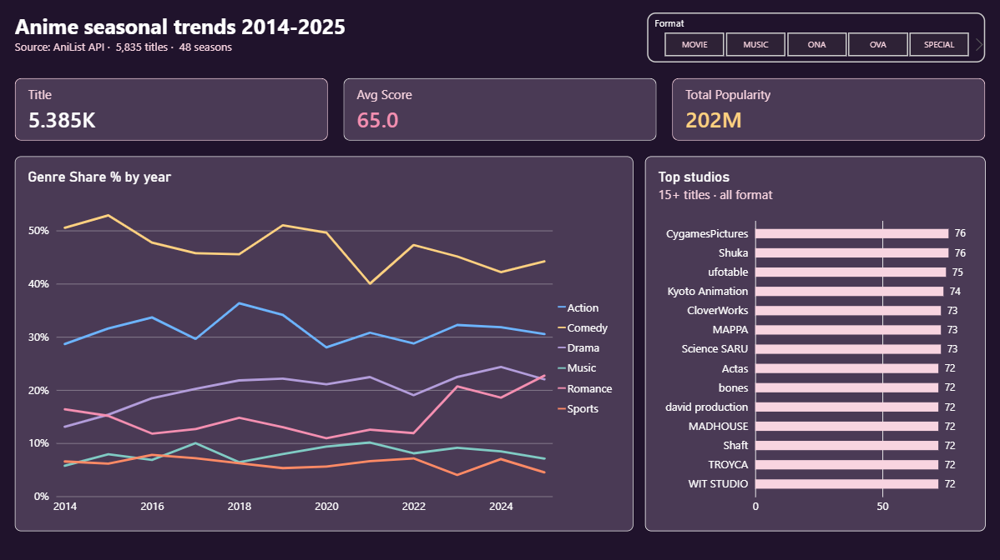
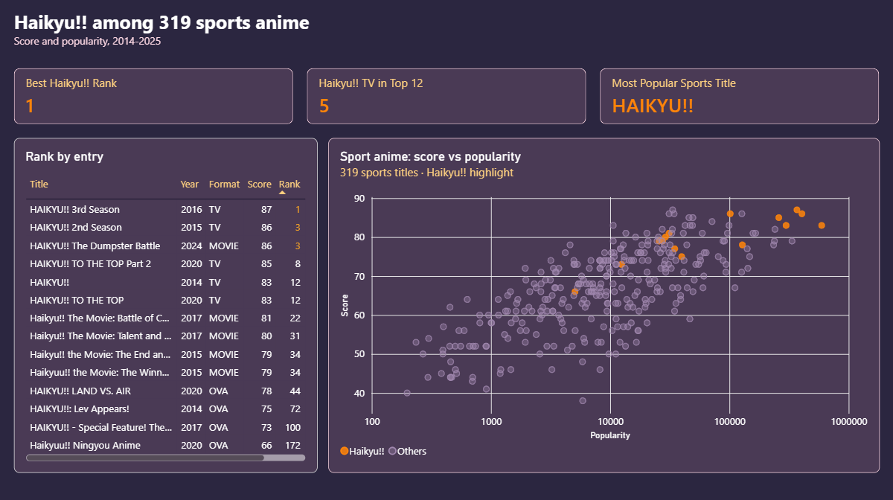
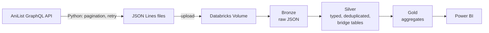
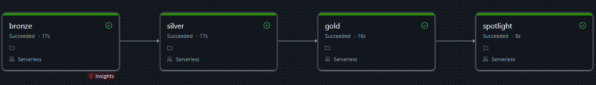

# Anime Seasonal Trends Pipeline

An end-to-end data pipeline that collects every anime season from 2014 to 2025 from the AniList GraphQL API, cleans it in a Databricks medallion architecture (bronze → silver → gold) and answers three questions in a Power BI dashboard.

**Tech:** Python · GraphQL API · Databricks · Spark SQL · Power BI





---

## Questions

1. Which genres and themes have grown over the last 12 years?
2. Does the source material (manga, light novel, original) affect scores?
3. Which studios score consistently well?
4. Where does *Haikyuu!!* rank among all sports anime?

## Key insights

1. **Isekai more than tripled its share of new anime**, from 3.3% of titles in 2014 (16 of 489) to 11.1% in 2025 (47 of 423). Roughly one in nine new anime is now an isekai.
2. **Manga adaptations score highest; original anime score lowest.** Manga adaptations average 68.2/100 across 1,868 titles, light novels 67.5, while original anime average 61.6 across 1,310 titles, 6.6 points lower.
3. **Among high-volume studios, ufotable, Kyoto Animation and MAPPA lead.** ufotable averages 75/100 over 24 titles, Kyoto Animation 74 over 65 and MAPPA 73 over 78. The top three overall have only 7–15 titles each, so their averages are less reliable.
4. **Haikyuu!! Season 3 is the highest-scored sports anime of 2014–2025**, #1 of 319 scored sports titles (87/100). Every Haikyuu!! TV season ranks in the top 12 (top 4%), and Season 1 is the most popular sports anime on AniList.

Other finding: the share of 80+ titles barely changes by season (7.0% in Summer to 7.6% in Fall and Winter), so there is no "strong season" for high-scoring anime.

## Architecture



| Layer | Tables | What happens |
|---|---|---|
| Bronze | `bronze_season_anime` | Raw JSON as received, plus ingestion metadata |
| Silver | `silver_anime`, `silver_anime_genre`, `silver_anime_tag`, `silver_anime_studio` | One row per title, typed columns, nested arrays split into bridge tables |
| Gold | `gold_season_summary`, `gold_genre_year`, `gold_studio`, `gold_sport_spotlight` | Aggregates ready for the dashboard |

The four layers run as a Databricks Job with chained tasks (bronze → silver → gold → spotlight). Each task waits for the previous one, so if silver fails, gold is not rebuilt from incomplete data.



## Extraction

`extract/extract_anilist.py` requests 48 seasons (4 per year × 12 years) from the AniList GraphQL API.

- **Pagination:** fetches 50 titles per page until `hasNextPage` is false
- **Rate limiting:** waits 2.5 s between calls to stay under AniList's limit of 30 requests per minute
- **Retries:** on HTTP 429 it waits for the `Retry-After` header; on 5xx it backs off exponentially (2, 4, 8 … s)
- **Idempotent:** seasons already on disk are skipped, and files are written to a temp name first, so a crash never leaves a half-written file
- **Format:** JSON Lines (one title per line) so files can be read line by line and loaded directly by Spark

## Data quality

| Check | Result |
|---|---|
| Raw rows (bronze) | 5,385 |
| Unique titles | 5,385 |
| Duplicate rows | 0 |
| Season mismatches | 0 |
| Titles without a score | 571 (10.6%), mostly TV shorts (205) and ONAs (192) with very low popularity (~160 users on average); only 25 are regular TV series |
| Titles without an episode count | 29 |
| Titles without an animation studio | 549 |
| Rows in `silver_anime` | 5,385 (matches unique titles ✓) |

Cleaning decisions:

- Kept only tags with `rank >= 60` so a title is tagged only when most voters agree the tag fits.
- Kept only studios flagged as animation studios, which excludes distributors and licensors.
- Gold tables store `score_sum` and `scored_titles` instead of a pre-computed average, so Power BI computes a correctly weighted average at any level of grouping.

## Challenges and decisions

- **Switched data source mid-project.** I first built the extractor for the Jikan (MyAnimeList) REST API, but its server timed out on every request. I moved to AniList, rewrote the request layer for GraphQL, and kept the rest of the pipeline the same.
- **Files nested one folder too deep.** Uploading the local folder put the files under `seasons/data/bronze/` in the Databricks Volume, so Spark found nothing at `seasons/` and failed with `UNABLE_TO_INFER_SCHEMA`. Listing the Volume showed where the files were, and pointing the bronze query at the right folder fixed it.
- **A query that ran but was wrong.** My first Isekai query returned 0 titles for every year. It ran without errors, but the result was impossible, so I traced it back: AniList stores the tag as `Isekai` and string comparison is case-sensitive. I switched to `lower(tag) = 'isekai'`. Since then I sanity-check results against what I know about the data, not just whether the query runs.

## Limitations

- Scores and popularity come from AniList users only, not from all viewers.
- Recent titles have had less time to collect users, so popularity is not directly comparable across years.
- Snapshot taken in November 2026; scores and popularity keep changing.
- Studio averages for studios with few titles (5–15) are sensitive to a single title.

## How to run

```bash
# 1. Extract
python -m venv .venv
.venv\Scripts\activate          # Mac/Linux: source .venv/bin/activate
pip install -r requirements.txt
python extract/extract_anilist.py

# 2. Upload data/bronze/*.jsonl to a Databricks Volume
# 3. Run databricks/01-bronze.sql → 02-silver.sql → 03-gold.sql → 04-sport_spotlight.sql
#    (or as a Databricks Job with those four tasks in sequence)
#    databricks/05-insight.sql holds the ad-hoc analysis queries behind the insights above
# 4. Open powerbi/anime_season_trends.pbix and point it at your SQL Warehouse
```

## Repository structure

```
anime-seasonal-trends/
├── extract/extract_anilist.py
├── databricks/
│   ├── 01-bronze.sql
│   ├── 02-silver.sql
│   ├── 03-gold.sql
│   ├── 04-sport_spotlight.sql
│   └── 05-insight.sql
├── powerbi/
│   ├── anime_season_trends.pbix
│   └── anime_night_theme.json
├── images/
├── requirements.txt
└── README.md
```

## Credits

Data from [AniList](https://anilist.co) via the [AniList API](https://docs.anilist.co/). Used for learning purposes only.
